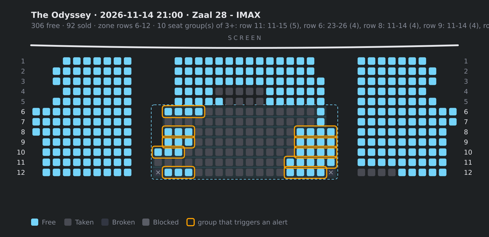

# Kinepolis notifier

Watches one film at Kinepolis Belgium and sends a push message when something
changes: a new screening or a new screening day, or a group of free seats
together in a good zone of the screen. Single free seats, front-row seats and
seats at the side wall do not cause a message. That is the noise this tool
removes.



> **Unofficial.** This tool uses the internal API of the Kinepolis mobile app
> (Vista OCAPI v1). We found the API by analysing that app. The token comes
> from the app's GAS endpoint. Kinepolis can change the API or the Cloudflare
> protection at any time. Be polite: one check every 10 minutes, not faster.

## Quick start

```bash
npm install
node setup.js               # wizard: film, cinema, attributes, zone, Pushover keys
node notifier.js --map      # check which seats are watched
node notifier.js --loop     # keep it running
```

The wizard writes `config.json` and `secrets.json`. You can also edit them by
hand. Start from `config.example.json`.

## Usage

```bash
node notifier.js --find <title>   # find the film id, cinemas and attributes
node notifier.js --loop           # keep running, interval from config
node notifier.js --map            # seat maps as text, with the zone marked
node notifier.js --testpush       # send one test message with a seat map
```

Each language version is a separate film with its own id. Find it with:

```
$ node notifier.js --find <title>

HO000AAAAA  Film Title · release 15/07/2026 · 2h52
    plays 02/11 to 17/11 at KBRU (Kinepolis Brussel), METRO (Kinepolis Antwerpen), …
    attributes: 2D (0000000036), Engelse versie (0000000067), IMAX (0000000056)
HO000BBBBB  Titre du film · release 15/07/2026 · 2h52
    plays 02/11 to 10/11 at KBRU (Kinepolis Brussel), KLUIK (Kinepolis Luik), …
    attributes: 2D (0000000036), Franse versie (0000000070), IMAX (0000000056)
```

Site, screen and attribute names come from the Kinepolis API as they are.

## Run continuously

Build the image and run it with a volume for the state:

```bash
docker build -t kinepolis-notifier .
docker run -d --name kinepolis-notifier --restart unless-stopped \
  -v "$PWD/config.json:/app/config.json:ro" \
  -v "$PWD/secrets.json:/app/secrets.json:ro" \
  -v kinepolis-data:/data \
  kinepolis-notifier
docker logs -f kinepolis-notifier
```

The image contains `rsvg-convert` for the seat map image. The state and the
seat map cache are on the volume, so a restart does not send the start message
again. Instead of `secrets.json` you can pass `PUSHOVER_TOKEN`, `PUSHOVER_USER`
and `PUSHOVER_ADMIN` with `-e`. `POLL_MINUTES` overrides `intervalSeconds`.

Without Docker: `node notifier.js --loop`.
Install `librsvg2-bin` for the image in the message.

## Configuration

```jsonc
{
  "intervalSeconds": 600,          // only for --loop; POLL_MINUTES overrides it
  "requestGapMs": 2100,            // minimum time between API calls
  "filter": {
    "label": "<film title> · <cinema>",   // free text, used in message titles
    "siteIds": ["KBRU"],           // cinema, see below
    "filmIds": ["HO000AAAAA"],     // from --find; one language version = one id
    "requiredAttributeIds": ["0000000056"]    // all must be present; 0000000056 = IMAX
  },
  "seats": {
    "enabled": true,
    "minAdjacent": 3,              // how many seats together
    "rowsFrom": 0.45, "rowsTo": 1.0,    // 0 = screen, 1 = back row
    "colsFrom": 0.28, "colsTo": 0.72,   // 0 = left, 1 = right
    "centreBlockOnly": true,       // only the block between the aisles
    "maxChecks": 30                // seat checks per run; the rest rotates to the next run
  }
}
```

**Sites:** `KBRU` Brussels · `METRO` Antwerp · `DECA` Ghent · `KLUIK` Liège ·
`KHAS` Hasselt · `KBRAI` Braine · `KKOR` Kortrijk · `KBRG` Bruges ·
`SL` Leuven · `KOOST` Ostend · `PAL` Palace Liège

**Attributes:** IMAX `0000000056` · 70mm `0000000040` · Laser Ultra `0000000058` ·
4DX `0000000085` · ScreenX `0000000099` · 2D `0000000036` · 3D `0000000037` ·
Dutch subtitles `0000000071` · French subtitles `0000000072`

## Seat zone

The zone is given in fractions of the screen, so the same setting works in any
screen. `rowsFrom`/`rowsTo` measure the depth from the screen (0) to the back
row (1). `colsFrom`/`colsTo` measure the width from left to right. With
`centreBlockOnly: true`, only the block between the aisles counts. An aisle, a
sold seat or a broken seat breaks a group. A message goes out only on the
change from 0 groups to at least 1. Always check a zone with
`node notifier.js --map`.

## Notifications

`secrets.json` (or the same names as environment variables):

```json
{
  "PUSHOVER_TOKEN": "…",
  "PUSHOVER_USER": ["key-one", "key-two"],
  "PUSHOVER_ADMIN": ["key-one"]
}
```

Problems with the notifier itself (token, API, film removed) go to
`PUSHOVER_ADMIN` only, after `FAIL_ALERT_AFTER` (default 3) failed runs.

## Notes

- The first run sends no message. It only records the current state as a
  baseline. Delete `state.json` to start again.
- The API token is valid for about 12 hours and is cached in `state.json`.
  Only the refresh uses cycletls; all other calls use the normal `fetch`.
- Cloudflare rate-limits the API at about 45 calls per run. `maxChecks` limits
  the seat checks per run; the rest rotates to the next run.
- The free-seat count in a message comes from the seat map, not from the
  summary endpoint. The summary endpoint lags behind.
- The seat map goes with the message as a PNG (via `rsvg-convert`). Without
  it, the message goes out without an image.
